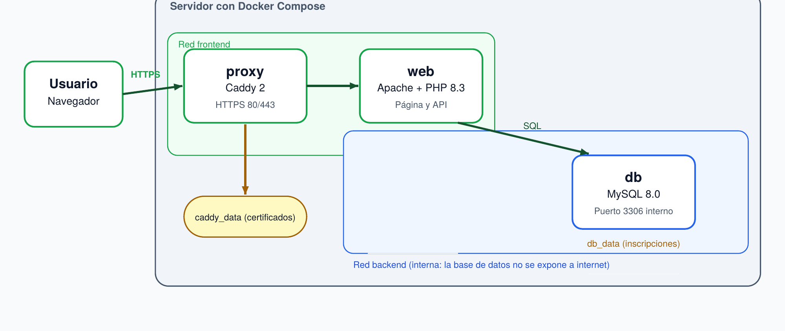

# 🎟️ Unitrópico Eventos

Página web para publicar eventos de la Universidad Unitrópico, inscribirse a ellos y validar la entrada con un código único. Proyecto académico.

## ✨ Funcionalidades

- Cartelera de eventos con buscador y filtros por categoría.
- Formulario de inscripción con datos del asistente: nombre, documento, correo, celular, vinculación, carrera y semestre.
- Validación de datos en el navegador y también en el servidor.
- Boleta con código único (`UT-XXXXXX`) y QR de demostración.
- Validación en puerta: el código solo se puede usar una vez.
- No permite inscribir dos veces el mismo documento al mismo evento.
- Diseño responsive (celular y computador).

## 🛠️ Tecnologías

HTML5 · CSS3 · JavaScript · PHP · MySQL (XAMPP)

## 📁 Estructura

```
unitropico-eventos/
├── index.html        # Página principal
├── styles.css        # Estilos
├── app.js            # Lógica de la interfaz
├── api/
│   ├── conexion.php  # Conexión a MySQL
│   ├── inscribir.php # Guarda una inscripción
│   └── validar.php   # Valida y marca la boleta como usada
└── db/
    └── schema.sql    # Script para crear la base de datos
```
## 🏗️ Arquitectura




## 🚀 Cómo ejecutarlo

1. Instala [XAMPP](https://www.apachefriends.org) y enciende **Apache** y **MySQL**.
2. Copia esta carpeta en `C:\xampp\htdocs\`.
3. Abre `http://localhost/phpmyadmin`, ve a la pestaña **SQL**, pega el contenido de `db/schema.sql` y ejecútalo.
4. Si cambiaste la contraseña de MySQL, edita `api/conexion.php`.
5. Entra a `http://localhost/unitropico-eventos/`.


## 🐳 Ejecutar con Docker

```bash
cp .env.example .env        # y cambia las claves
docker compose up -d --build
```

Abre `https://localhost` (el navegador avisará del certificado local; es normal).
Si usas XAMPP, apaga Apache primero porque ambos usan el puerto 80.

- Pruebas automáticas: `bash tests/smoke.sh https://localhost`
- Diagrama de arquitectura: [`docs/arquitectura.svg`](docs/arquitectura.svg)
- Guía de despliegue: [`docs/despliegue.md`](docs/despliegue.md)
- Informe de rendimiento: [`docs/informe-lighthouse.md`](docs/informe-lighthouse.md)
- CI/CD: `.github/workflows/ci-cd.yml` (pruebas → imagen → despliegue en cada cambio a `main`).

## 🗄️ Base de datos

Base `unitropico_eventos`, tabla `inscripciones` (código, evento, datos del asistente, estado de uso y fechas).

## 🔮 Próximos pasos

- Guardar los eventos en MySQL.
- Panel del organizador con lista de inscritos y exportación a CSV.
- QR real escaneable.

## 👤 Autor

Daniel Gómez pidiache — Universidad Unitrópico Del tropico Americano
